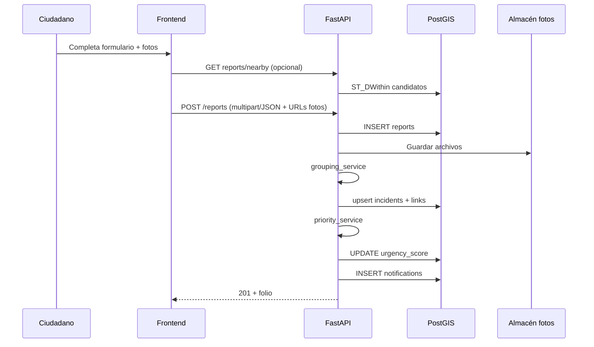
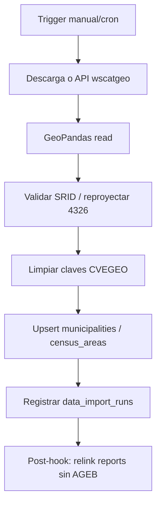

# Flujos de datos

## Registro de reporte

## Agrupamiento

Entrada: nuevo `report` con `location` y categoría elegible.  
Pasos:

1. Buscar incidencias abiertas en radio `GROUPING_DISTANCE_M` (default 75).
2. Si hay match, asignar `incident_id`; si no, crear incidencia con centroide inicial.
3. Recalcular `report_count`, `confirmation_count` en incidencia.

## Priorización

Disparada tras cambios en gravedad, conteos o tiempo. Servicio invoca `compute_urgency()` — ver [../07-business-logic/incident-prioritization.md](../07-business-logic/incident-prioritization.md).

## Importación INEGI

## Fotografías

1. Cliente sube a `POST /reports/{id}/photos`.
2. API valida MIME/tamaño, genera nombre opaco (UUID), guarda metadata en `report_photos`.
3. Descarga admin vía endpoint autenticado; público no accede a EXIF/PII.

## Mapa público

Solo campos whitelisted en DTO `PublicIncident`: id, categoría, estado agregado, urgencia, coordenadas, conteos — sin `user_id`.