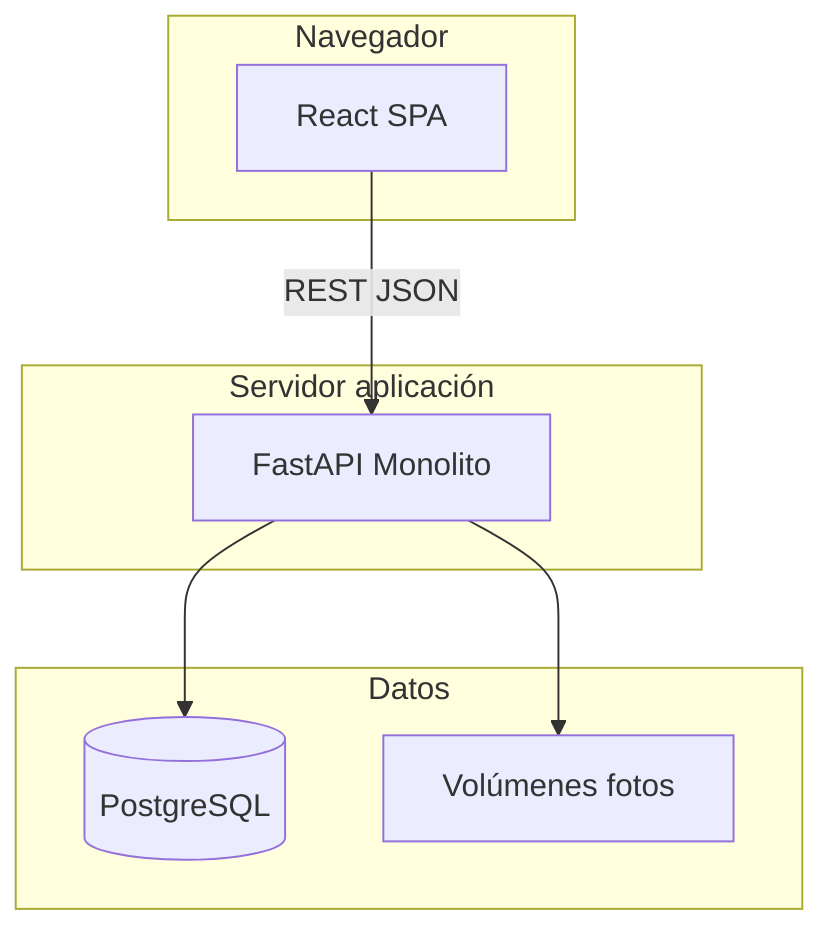
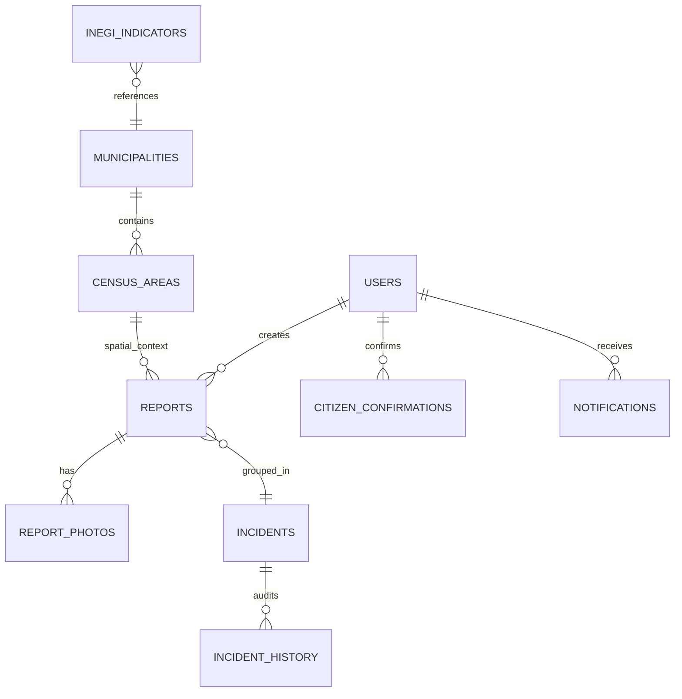
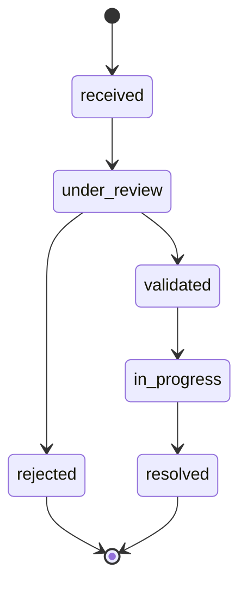
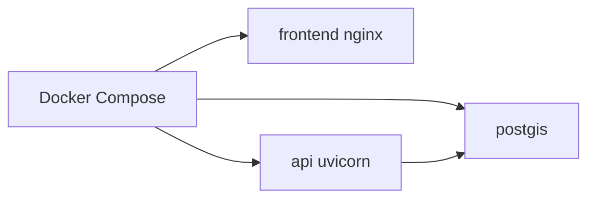

# Diagramas de arquitectura

## Contenedor (C4 simplificado)

## Modelo de dominio (conceptual)

Diagrama físico tablas: [../04-database/entity-relationship.md](../04-database/entity-relationship.md).

## Estados — reporte

## Estados — incidencia (operativa)

`open` → `triaged` → `in_progress` → `resolved` | `dismissed` (sincronización parcial con reportes documentada en servicio).

## Despliegue MVP

Detalle infra: [../11-infrastructure/docker-architecture.md](../11-infrastructure/docker-architecture.md).