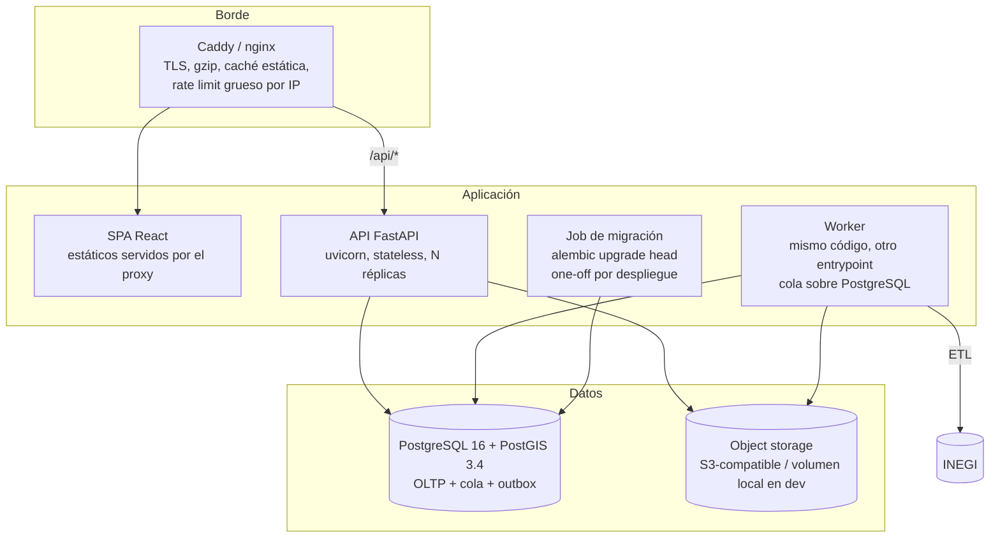
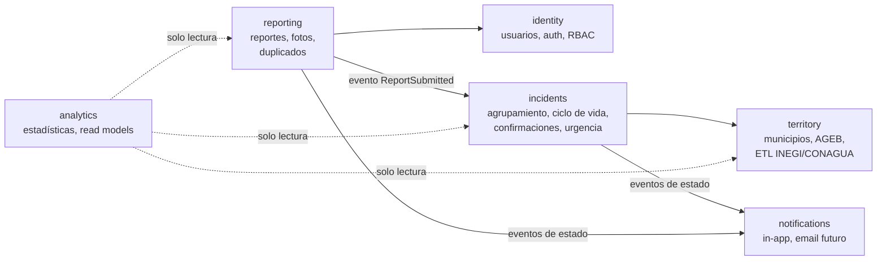
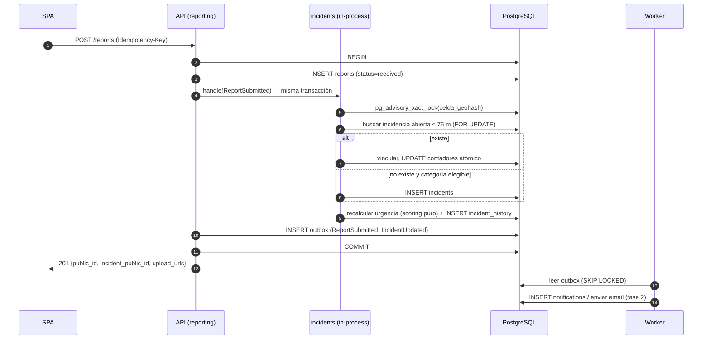
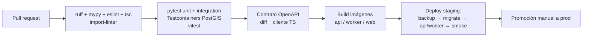

# Arquitectura de referencia — Agua Alerta (revisión senior)

> **Propósito:** consolidar la especificación existente en una arquitectura ejecutable, tomar las decisiones que quedaron abiertas y corregir los puntos débiles detectados antes de escribir código.
> **Estado:** revisado contra el MVP implementado en `main` (commit `43818b0`: API FastAPI, frontend React, Docker). La sección [15](#15-estado-del-código-actual-frente-a-esta-arquitectura) indica, para cada punto, si el código ya lo cumple, lo cumple a medias o lo contradice, con archivo y línea.
> **Relación con otros documentos:** este documento **no reemplaza** a los canónicos (diccionario de datos, endpoints, algoritmo de urgencia); los **complementa** y, donde hay conflicto, propone el cambio explícitamente en la sección [Hallazgos sobre la especificación actual](#12-hallazgos-sobre-la-especificación-actual) y como ADR nuevo.

---

## 1. Drivers arquitectónicos

Antes de dibujar cajas, lo que realmente manda en este sistema:

| # | Atributo de calidad | Por qué importa aquí | Consecuencia de diseño |
|---|---------------------|----------------------|------------------------|
| 1 | **Integridad y trazabilidad** | Datos usados para priorizar obra pública; debe ser auditable | Reportes inmutables, historial append-only, scoring versionado |
| 2 | **Correctitud geoespacial bajo concurrencia** | Dos ciudadanos reportan la misma fuga al mismo tiempo → no deben nacer dos incidencias | Locks transaccionales en agrupamiento (§5) |
| 3 | **Privacidad** | Ubicación precisa + fotos + email = PII sensible (LFPDPPP) | Ubicación pública ofuscada determinísticamente, EXIF eliminado, seudonimización ARCO |
| 4 | **Explicabilidad** | Una autoridad tiene que justificar por qué atendió A antes que B | Urgencia determinista con desglose persistido |
| 5 | **Simplicidad operativa** | Equipo pequeño, posible operación municipal con poca capacidad de infra | Monolito modular, **solo PostgreSQL** como infraestructura de estado (sin Redis/Rabbit en MVP) |
| 6 | **Rendimiento de lectura del mapa** | El tráfico dominante es público y de lectura | Read model dedicado, caché HTTP, clustering en servidor |

Escala objetivo del MVP (piloto municipal): < 100k reportes, < 20k incidencias, < 50 req/s pico. Esto **cabe holgado en un solo nodo PostgreSQL**; cualquier diseño distribuido sería sobre-ingeniería (coherente con ADR-001).

---

## 2. Vista de contexto (C4 nivel 1)

```mermaid
flowchart LR
  ciud([Ciudadano]) -->|Reporta, confirma, consulta| AA
  admin([Administrador / Superadmin]) -->|Valida, prioriza, opera| AA
  AA[[Agua Alerta]]
  AA -->|Tiles base| OSM[(OpenStreetMap)]
  AA -->|Descarga Marco Geoestadístico / Censo| INEGI[(INEGI)]
  AA -.->|Fase 2: catálogos| CONAGUA[(CONAGUA)]
  AA -.->|Fase 2: email transaccional| SMTP[(Proveedor email)]
  AA -.->|Fase 3: integración| OO[(Sistema del organismo operador)]
```



---

## 3. Vista de contenedores (C4 nivel 2)

Cambio principal frente a `system-architecture.md`: se agrega un **worker** desde el MVP y el **reverse proxy** pasa a ser la única puerta de entrada.



| Contenedor | Responsabilidad | Escala |
|------------|-----------------|--------|
| **proxy** | TLS, servir SPA, enrutar `/api`, headers de seguridad, caché de `GET /public/*` | 1 |
| **api** | HTTP síncrono: comandos y consultas | Horizontal (stateless) |
| **worker** | Outbox → notificaciones, recálculo periódico de urgencia, ETL INEGI, procesamiento de fotos | 1 (MVP), horizontal después |
| **migrate** | Migraciones Alembic **antes** de levantar `api` (nunca en el arranque de la API: con N réplicas compiten) | Job |
| **postgres** | Fuente única de verdad, incluida la cola de trabajos | Vertical; réplica de lectura en fase 3 |
| **object storage** | Fotos originales y derivadas | Gestionado |

**Decisión: cola sobre PostgreSQL** (`procrastinate` o `SELECT … FOR UPDATE SKIP LOCKED` propio) en lugar de Celery + Redis. Razón: una pieza de infraestructura menos que operar, respaldar y asegurar; transaccional con los datos de negocio (encolar dentro de la misma transacción que crea el reporte); el volumen del MVP está órdenes de magnitud por debajo del límite de este patrón. → **ADR-011**.

---

## 4. Vista de componentes: monolito modular de verdad

La estructura actual de `backend-architecture.md` está organizada por **capa técnica** (`services/`, `repositories/`, `models/`). Eso produce un "monolito en capas", no uno modular: nada impide que `reports_service` toque directamente las tablas de incidencias y, en seis meses, todo depende de todo.

Propuesta: **organizar por módulo de negocio (bounded context)** y que cada módulo tenga sus propias capas internas.

### 4.1 Módulos



| Módulo | Es dueño de (tablas) | Expone |
|--------|----------------------|--------|
| `identity` | `users`, `refresh_tokens` | `current_user`, `require_role()` |
| `reporting` | `reports`, `report_photos` | `ReportSubmitted`, `ReportValidated`, `ReportRejected` |
| `incidents` | `incidents`, `incident_reports` (si se normaliza), `citizen_confirmations`, `incident_history` | `IncidentOpened`, `IncidentStatusChanged`, API pública de incidencias |
| `territory` | `municipalities`, `census_areas`, `inegi_indicators`, `data_source_catalog`, `data_import_runs` | `locate(point) -> TerritorialContext` (función pura de consulta) |
| `notifications` | `notifications`, `outbox` (consumidor) | Handlers de eventos |
| `analytics` | Vistas / vistas materializadas | Endpoints de estadísticas |

**Reglas de dependencia** (se hacen cumplir en CI con `import-linter`, no con buenas intenciones):

1. Un módulo solo importa de otro a través de su `public.py` (fachada); nunca sus `models` o `repositories`.
2. Ningún módulo escribe en tablas de otro. La comunicación de escritura entre módulos es por **evento de dominio**.
3. `domain/` de cada módulo no importa FastAPI, SQLAlchemy ni nada de I/O.
4. `territory` no depende de nadie (es un servicio de referencia).

### 4.2 Estructura de código

```text
backend/
├── pyproject.toml              # uv / ruff / mypy / import-linter
├── alembic/
├── app/
│   ├── main.py                 # create_app(): monta routers de cada módulo
│   ├── worker.py               # entrypoint del worker
│   ├── platform/               # transversal, sin lógica de negocio
│   │   ├── config.py           # pydantic-settings
│   │   ├── db.py               # engine, session, unit of work
│   │   ├── events.py           # bus in-process + outbox
│   │   ├── storage.py          # interfaz BlobStorage (Local / S3)
│   │   ├── logging.py          # structlog + request_id
│   │   ├── errors.py           # mapeo excepción de dominio → HTTP
│   │   └── security.py         # hashing, JWT
│   └── modules/
│       ├── identity/
│       ├── reporting/
│       │   ├── api.py          # router FastAPI
│       │   ├── schemas.py      # DTOs Pydantic
│       │   ├── service.py      # casos de uso (orquestación, transacción)
│       │   ├── repository.py   # SQLAlchemy + PostGIS
│       │   ├── models.py       # ORM
│       │   ├── domain.py       # entidades, reglas puras, enums
│       │   ├── handlers.py     # suscripciones a eventos
│       │   └── public.py       # fachada para otros módulos
│       ├── incidents/
│       │   ├── ...
│       │   └── scoring.py      # compute_urgency() puro, versionado
│       ├── territory/
│       │   ├── ...
│       │   └── etl/            # pipelines GeoPandas (solo los ejecuta el worker)
│       ├── notifications/
│       └── analytics/
└── tests/
    ├── unit/                   # dominio puro, sin DB
    ├── integration/            # Testcontainers PostGIS real
    └── contract/               # snapshot de OpenAPI
```

Nota: GeoPandas/GDAL solo son necesarios en el worker. Se instalan como *extra* (`pip install .[etl]`) para que la imagen de la API no cargue ~400 MB de dependencias geoespaciales nativas.

### 4.3 Sync vs async

FastAPI con **SQLAlchemy síncrono** y handlers `def` (no `async def`) en el MVP. Razón: el cuello de botella es PostgreSQL, no el event loop; el código síncrono es más simple de depurar y de testear, y GeoAlchemy2 + psycopg 3 funcionan sin fricción. Se revisa solo si aparece I/O externo intensivo en la API (no es el caso: el I/O externo vive en el worker).

---

## 5. Modelo transaccional y de concurrencia

Esta es la parte que más se subestima en la especificación actual.

### 5.1 Caso de uso "enviar reporte"



Decisiones:

- **Agrupamiento síncrono dentro de la transacción** del reporte: el ciudadano recibe en la respuesta a qué incidencia quedó vinculado. Cuesta unos milisegundos y elimina toda una clase de inconsistencias eventuales.
- **Efectos secundarios (notificaciones, email, procesamiento de fotos) vía outbox**: nunca se pierde un evento si la transacción hace commit, y nunca se emite uno si hace rollback.
- **Idempotencia**: header `Idempotency-Key` en `POST /reports` y `POST /incidents/{id}/confirmations`. Las redes móviles reintentan; sin esto, cada reintento crea un reporte.

### 5.2 Condición de carrera en el agrupamiento

Sin control, dos reportes simultáneos a 20 m uno del otro ejecutan "¿hay incidencia cercana?" → ambos ven "no" → **se crean dos incidencias**. Con concurrencia de lectura en PostgreSQL esto ocurre aunque la búsqueda sea correcta.

Solución: `pg_advisory_xact_lock(hash(geohash_precision_6))` sobre la celda del punto **y sus 8 vecinas** (una celda de geohash-6 mide ~1.2 km × 0.6 km, mucho mayor que el radio de 75 m, así que basta con la celda propia + vecinas ordenadas para evitar deadlocks). El lock se libera solo al terminar la transacción. Serializa únicamente reportes de la misma zona; el resto del sistema no se entera.

### 5.3 Contadores denormalizados

`report_count` y `confirmation_count` se actualizan con `UPDATE incidents SET confirmation_count = confirmation_count + 1` (atómico), nunca con "leer, sumar en Python, escribir". Un job nocturno reconcilia contadores contra conteos reales y alerta si difieren.

### 5.4 Centroide que "camina"

La regla actual (centroide = media de los reportes vinculados) permite que una incidencia se desplace con cada reporte nuevo y termine absorbiendo reportes a 200 m del original (encadenamiento). Propuesta:

- `anchor_location`: fijo, el del primer reporte; **el radio de agrupamiento se mide contra el ancla**.
- `centroid`: media recalculada, solo para visualización.
- Fusión de incidencias distintas: siempre manual (admin), con evento `IncidentsMerged` en historial.

---

## 6. Urgencia: cálculo, frescura y explicabilidad

El algoritmo (`incident-prioritization.md`) está bien planteado. Problemas de implementación a resolver:

1. **El componente T depende del tiempo**, así que un `urgency_score` almacenado queda obsoleto en cuanto pasa una hora. Opciones:
   - (a) Calcularlo al leer, en SQL — complica ordenar/paginar y duplica la fórmula en SQL y Python.
   - (b) **Persistir y refrescar con un job cada 15 min** en el worker + recálculo inmediato en cada evento relevante. ✅ Elegida: una sola implementación (Python pura), ordenación por índice, desfase máximo de 15 min en T (≈ 0.015 pts), irrelevante.
2. **Persistir el desglose**: `urgency_breakdown jsonb` (`{"S":32,"C":15,"I":17.1,"T":2.1,"version":"2025.1"}`) y `urgency_version`. Cuando cambien los pesos se sabrá con qué fórmula se priorizó cada caso; esto es lo que hace defendible la priorización ante un cabildo o una auditoría.
3. **Pesos y umbrales en configuración versionada**, no en constantes dispersas. `scoring.py` recibe un `ScoringPolicy` inmutable.
4. **Anti-inflación**: `r` efectivo = reportes de **usuarios distintos**; `k` excluye a quien ya reportó en esa incidencia. Sin esto, una sola persona con dos cuentas mueve 30 puntos.

---

## 7. Datos y geoespacial

### 7.1 Tipos de geometría

| Dato | Tipo | Razón |
|------|------|-------|
| Puntos (`reports.location`, `incidents.anchor_location`, `centroid`) | `geography(Point,4326)` | `ST_DWithin` en metros sin reproyectar |
| Polígonos (`census_areas.geom`, `municipalities.geom`) | **`geometry(MultiPolygon,4326)`** | `ST_Covers`/`ST_Intersects` sobre `geography` es bastante más lento y no aporta nada para punto-en-polígono |
| Ubicación pública ofuscada | `geography(Point,4326)` columna aparte | Ver §8.2 |

La asignación de AGEB pasa a `ST_Covers(ca.geom, point::geometry)` con desempate determinista por `cvegeo` (el truco del buffer + área de la spec actual es caro e innecesario para un punto).

### 7.2 Esquema: cambios propuestos

- `incident_reports` vs FK `reports.incident_id`: mantener la FK (1 reporte ↔ 1 incidencia) es suficiente; el historial de re-vinculaciones va en `incident_history`.
- Estados del reporte: hoy se duplican (`in_progress`, `resolved` existen en reporte **e** incidencia). El reporte debe tener solo estado de **validación** (`received → under_review → validated | rejected`); el estado operativo es de la incidencia y el ciudadano lo ve a través de ella. Elimina la sincronización "configurable" que tarde o temprano diverge.
- `outbox(id, aggregate, event_type, payload jsonb, created_at, processed_at)` y tabla de cola del worker.
- `idempotency_keys(key, user_id, response_hash, created_at)` con TTL 24 h.
- Todas las tablas de negocio con `created_at`, `updated_at`; `incident_history` y `outbox` **append-only** (revocar `UPDATE/DELETE` al rol de la app sobre `incident_history`).

### 7.3 ETL territorial

- Corre **solo en el worker** (o como comando `python -m app.modules.territory.etl ...`), jamás en un request HTTP.
- Patrón **staging → validar → swap**: cargar a `census_areas_staging`, validar (conteo, SRID, `ST_IsValid`, claves CVEGEO únicas, cobertura esperada), y reemplazar en una transacción. Una importación fallida nunca deja la tabla viva a medias.
- Cada corrida queda en `data_import_runs` con checksum del archivo fuente y versión del Marco Geoestadístico.
- Post-hook: re-asignar `census_area_id` de incidencias abiertas y recalcular urgencia (evento `TerritoryReloaded`).

---

## 8. Lectura pública y privacidad

### 8.1 Read model del mapa

El mapa público es el endpoint más consultado y el más expuesto. Se separa del modelo de escritura:

- Vista materializada (o tabla mantenida por evento) `public_incidents` con **solo** los campos whitelisted: `public_id`, categoría, estado agregado, banda, `public_location`, conteos, `updated_at`.
- `GET /api/v1/public/incidents?bbox=…&zoom=…`
  - zoom bajo: clusters calculados en servidor (`ST_SnapToGrid` por zoom) → respuesta pequeña;
  - zoom alto: puntos individuales, límite duro de 1 000.
- `Cache-Control: public, max-age=30` + `ETag`; el proxy absorbe picos (un municipio entero abriendo el mapa tras una noticia).
- Fase 3, si se superan ~20k incidencias visibles: vector tiles con `ST_AsMVT`.

### 8.2 Ofuscación de ubicación (decisión pendiente → se cierra)

Se adopta jitter **determinista**: `public_location = snap a una malla de ~30 m + desplazamiento derivado de HMAC(secret, incident_id)`. Si fuera aleatorio por request, promediar varias consultas revelaría la ubicación exacta. Se calcula una vez al crear/mover la incidencia. Las fugas en vía pública no requieren más precisión para el ciudadano; el admin ve la ubicación real.

### 8.3 Visibilidad en mapa público (decisión pendiente → se cierra)

Se muestra una incidencia en cuanto tiene **≥ 1 reporte en `under_review` o `validated`**, con badge "sin validar" si ninguno está validado. Las incidencias con un único reporte de una cuenta de menos de 24 h **no** se publican hasta validación. Equilibra utilidad (la gente ve que su reporte "existe") contra abuso (cuentas recién creadas sembrando el mapa).

### 8.4 Fotografías

1. `POST /reports` devuelve URLs de subida prefirmadas (S3) o un endpoint de subida (local).
2. El worker procesa: valida magic bytes, **elimina EXIF** (las fotos de celular traen GPS y modelo del dispositivo: es PII), re-codifica a JPEG/WebP, genera miniatura, calcula hash perceptual para detectar la misma foto reutilizada.
3. Solo la versión procesada es servible; la descarga admin es por URL prefirmada de corta vida (5 min), nunca por ruta pública.
4. `BlobStorage` es una interfaz desde el día 1 (`LocalStorage` en dev, `S3Storage` en staging/prod), así migrar de volumen a S3 es cambiar configuración, no código.

---

## 9. Seguridad

| Tema | Decisión |
|------|----------|
| Tokens | Access JWT (15 min) **en memoria** del SPA; refresh token **opaco**, en cookie `HttpOnly; Secure; SameSite=Strict; Path=/api/v1/auth`, almacenado hasheado en `refresh_tokens` con rotación y detección de reuso (si se reusa uno rotado → revocar toda la familia). Nunca `localStorage`. |
| CSRF | Cubierto por `SameSite=Strict` + cookie limitada a la ruta de refresh; el resto de la API usa header Bearer. |
| Hash de contraseñas | Argon2id (`argon2-cffi`). |
| Rate limiting | Dos niveles: grueso por IP en el proxy; fino por usuario en la app **persistido en PostgreSQL** (ventana deslizante). Un rate limiter en memoria con varios workers de uvicorn no limita nada: cada proceso cuenta por separado. |
| Anti-bot | Captcha sin fricción (Cloudflare Turnstile o hCaptcha) en registro y creación de reporte. |
| Verificación | Email verificado requerido para que un reporte cuente en la urgencia (puede crearse antes, pero `C` lo ignora). |
| RBAC | `require_role()` en routers **y** verificación de propiedad en servicios (`report.user_id == current_user.id`) — los IDOR se previenen en la capa de servicio, no en la ruta. IDs públicos (`public_id`) no secuenciales. |
| Headers | CSP estricta, HSTS, `X-Content-Type-Options`, `Referrer-Policy` en el proxy. |
| ARCO / LFPDPPP | Ver §12, hallazgo H5. |
| Secretos | Variables de entorno inyectadas por el orquestador; nunca en imagen. `JWT_SECRET` y `LOCATION_HMAC_SECRET` rotables. |
| Auditoría | Toda acción admin → `incident_history` o `audit_log` con `actor_user_id`, IP, `request_id`. |

---

## 10. Frontend

La estructura `features/` de `frontend-architecture.md` es correcta. Ajustes:

- **Dos bundles por división de rutas** (`React.lazy`): ciudadano/público y admin. El ciudadano en un celular de gama baja no descarga tablas y gráficas de admin.
- **Cliente API generado** desde `openapi.json` (`openapi-typescript` + `openapi-fetch`) en CI; si el contrato cambia y el frontend no compila, el error aparece en el PR, no en producción.
- **TanStack Query** para estado de servidor; nada de duplicarlo en un store global. Estado de auth en un contexto mínimo (access token en memoria + refresh silencioso).
- **Formulario de reporte resiliente**: borrador en `IndexedDB`, reintento con la misma `Idempotency-Key`. Fase 2: PWA con cola offline (muchos reportes se hacen en la calle con mala señal).
- Mapa: `react-leaflet` + clusters del servidor en zoom bajo; `leaflet.markercluster` solo para el nivel de detalle.
- Tiles OSM: la política de uso de tile.openstreetmap.org **no admite** tráfico de producción significativo. Para staging/producción usar un proveedor (MapTiler, Stadia, etc.) o servir tiles propios. → **ADR-014**.

---

## 11. Operación

### 11.1 Observabilidad

- **Logs**: `structlog` JSON a stdout con `request_id`, `user_id` (seudónimo), módulo, latencia.
- **Errores**: Sentry (backend y frontend).
- **Métricas**: OpenTelemetry → Prometheus/Grafana: latencia p95 por endpoint, tamaño de outbox pendiente, edad del evento más viejo, duración de ETL.
- **Métricas de negocio** (son las que alertan de problemas reales): reportes/hora, % de reportes que crean incidencia nueva vs se agrupan, tiempo medio a validación, incidencias críticas sin atender > 24 h.
- **Health**: `/health/live` (proceso vivo) y `/health/ready` (DB alcanzable, migraciones al día).

### 11.2 Entrega



- Migraciones **compatibles hacia atrás** (expand → migrate → contract) para poder desplegar sin downtime y revertir la app sin revertir el esquema.
- Tests de integración **siempre contra PostGIS real** (Testcontainers). SQLite no sirve aquí: ninguna consulta espacial sería válida.
- Tests "golden" para `compute_urgency` con los vectores del documento de priorización; cambiar la fórmula obliga a cambiar `urgency_version`.

### 11.3 Topología por entorno

| Entorno | Topología |
|---------|-----------|
| local | Docker Compose: postgis, api (reload), worker, vite dev server, MinIO |
| staging | 1 VM con Compose o PaaS de contenedores; PostgreSQL gestionado con PostGIS; bucket S3 |
| producción | 2 réplicas api + 1 worker detrás del proxy; PostgreSQL gestionado con PITR; CDN para estáticos |

Backups: PITR del proveedor + `pg_dump` lógico diario a otro proveedor/región; **restauración probada trimestralmente** (un backup no probado no existe).

---

## 12. Hallazgos sobre la especificación actual

| ID | Hallazgo | Riesgo | Propuesta |
|----|----------|--------|-----------|
| H1 | Agrupamiento sin control de concurrencia | Incidencias duplicadas bajo carga real | Advisory lock por celda (§5.2) |
| H2 | Centroide = media móvil y radio medido contra él | Incidencias que "caminan" y absorben reportes lejanos | `anchor_location` fijo (§5.4) |
| H3 | `urgency_score` persistido con componente temporal | Ordenación admin incorrecta con el paso del tiempo | Recálculo periódico + desglose versionado (§6) |
| H4 | Estados operativos duplicados en reporte e incidencia | Divergencia de estados | Reporte solo con estado de validación (§7.2) |
| H5 | ADR-003 "nunca eliminar reportes" vs derecho de cancelación ARCO (LFPDPPP) | Incumplimiento legal | Inmutabilidad del **hecho** (ubicación, categoría, fecha), no de la **persona**: ante solicitud ARCO se seudonimiza `user_id`, se borran email/nombre y fotos con personas identificables; el reporte sigue contando para estadística |
| H6 | Rate limiting sin almacén compartido | Límite inefectivo con varios workers | Contadores en PostgreSQL (§9) |
| H7 | Migraciones en el arranque de la API (orden de arranque en `docker-architecture.md`) | Carreras con varias réplicas | Job de migración separado (§3) |
| H8 | Almacenamiento de refresh token sin decidir | XSS → robo de sesión si va a `localStorage` | Cookie HttpOnly + rotación con detección de reuso (§9) |
| H9 | Uso de tiles de tile.openstreetmap.org en producción | Bloqueo por política de uso de OSM | Proveedor de tiles (§10) |
| H10 | EXIF solo "opcional futuro" | Fuga de GPS/dispositivo del ciudadano | Strip EXIF obligatorio en MVP (§8.4) |
| H11 | Factor C cuenta reportes/confirmaciones sin deduplicar personas | Manipulación de prioridad | Contar usuarios distintos y verificados (§6) |
| H12 | Consulta AGEB con buffer + área | Costosa e innecesaria | `ST_Covers` sobre `geometry` (§7.1) |
| H13 | Sin idempotencia en POST | Reportes duplicados por reintentos móviles | `Idempotency-Key` (§5.1) |

---

## 13. ADRs nuevas propuestas

| ID | Decisión | Estado |
|----|----------|--------|
| ADR-011 | Cola de trabajos y outbox sobre PostgreSQL (sin Redis en MVP) | Propuesta |
| ADR-012 | Monolito modular por bounded context con `import-linter` | Propuesta |
| ADR-013 | Agrupamiento síncrono con advisory locks y ancla fija | Propuesta |
| ADR-014 | Proveedor de tiles para staging/producción | Propuesta |
| ADR-015 | Refresh token opaco en cookie HttpOnly con rotación | Propuesta |
| ADR-016 | Ubicación pública con jitter determinista (HMAC) | Propuesta |
| ADR-017 | Urgencia persistida con desglose y versión de política | Propuesta |
| ADR-018 | Seudonimización ARCO compatible con inmutabilidad de reportes (enmienda ADR-003) | Propuesta |

Redactarlas con [adr-template.md](../13-decisions/adr-template.md) al aprobar este documento.

---

## 14. Evolución

| Fase | Disparador | Cambio |
|------|-----------|--------|
| MVP | — | Todo lo anterior: 1 PostgreSQL, api + worker, in-app notifications |
| Fase 2 | Piloto validado | Email transaccional (consumidor del outbox), PWA offline, exportación ARCO, CONAGUA |
| Fase 3 | > 20k incidencias visibles o > 200 req/s | Vector tiles, réplica de lectura para `analytics`, CDN para `GET /public/*` |
| Fase 4 | Integración con organismo operador | Módulo `integrations` con webhooks firmados salientes (eventos de incidencia) y API para órdenes de trabajo; ese módulo es el primer candidato real a extraerse como servicio |

Regla para extraer un módulo a servicio: solo cuando tenga **un equipo, un ritmo de despliegue o un perfil de escala distinto** al resto. Ninguno lo tiene hoy.

---

## 15. Estado del código actual frente a esta arquitectura

Revisión de `backend/` y `frontend/` en `main` (`43818b0`). Leyenda: ✅ cumple · 🟡 parcial · ❌ pendiente o contradice.

### 15.1 Hallazgos de §12 confirmados en el código

| ID | Estado | Evidencia | Acción concreta |
|----|--------|-----------|-----------------|
| H1 | ❌ | `backend/app/services/grouping.py:18` busca la incidencia cercana sin lock; dos reportes simultáneos crean dos incidencias | `pg_advisory_xact_lock` por celda + `FOR UPDATE` antes de `find_nearby_incident` |
| H2 | ❌ | `grouping.py:38` `recalc_centroid` mueve el centroide y la búsqueda mide contra él | Columna `anchor_location` (migración 002) y medir el radio contra ella |
| H3 | ❌ | `app/services/priority.py` solo recalcula en eventos; no hay job periódico ni desglose persistido | Job en worker cada 15 min + columnas `urgency_breakdown`, `urgency_version` |
| H6 | ❌ | `app/core/rate_limit.py:7` diccionario en memoria por proceso; además `/auth/login` no tiene límite | Contadores en PostgreSQL; limitar login (5/15 min) |
| H7 | ❌ | `docker-compose.yml:33` ejecuta `alembic upgrade head` en el arranque de `api` | Servicio `migrate` one-off; `api` depende de él con `service_completed_successfully` |
| H8 | ❌ | `frontend/src/shared/api/client.ts:14` guarda el refresh token en `localStorage`; **no existe endpoint `/auth/refresh`** (los tokens se guardan hasheados pero nunca se usan) y `logout` (`app/api/v1/auth.py:73`) no revoca nada | Implementar refresh con cookie HttpOnly y rotación; logout revoca la familia |
| H9 | ❌ | `frontend/src/shared/map/IncidentsMap.tsx:47` usa `tile.openstreetmap.org` | URL de tiles por variable de entorno; proveedor en staging/prod |
| H10 | ❌ | `app/api/v1/reports.py:234` confía en el `content_type` del cliente; no valida magic bytes ni elimina EXIF | Validar con Pillow, re-codificar (descarta EXIF) |
| H11 | ❌ | `app/api/v1/incidents.py:89` incrementa confirmaciones sin considerar si quien confirma ya reportó | Excluir reportantes; contar usuarios distintos en `r` |
| H12 | ❌ | `app/services/spatial.py:23` usa `ST_Area(ST_Intersection(...))` para un punto | `ST_Covers` + desempate por `cvegeo` |
| H13 | ❌ | `POST /reports` sin `Idempotency-Key` | Tabla `idempotency_keys` + dependencia FastAPI |
| H4 | 🟡 | Se mantienen estados operativos en el reporte | Ver §7.2 al hacer la migración 002 |
| H5 | ❌ | `alembic/versions/001_initial_schema.py:225` `incident_history` con `ON DELETE CASCADE`: borrar una incidencia borra su auditoría | `ON DELETE RESTRICT` en historial; seudonimización en vez de borrado |

### 15.2 Defectos nuevos encontrados en la implementación

| # | Severidad | Dónde | Problema | Corrección |
|---|-----------|-------|----------|------------|
| D1 | Alta | `app/services/grouping.py:101` | El contexto territorial se escribe con un `UPDATE` SQL directo (`spatial.py`), pero luego se lee `report.municipality_id` del objeto ORM, que no se refresca. Muy probablemente la incidencia queda sin municipio ni AGEB y el componente **I** de la urgencia es siempre 0 | Devolver `(census_area_id, municipality_id)` desde `assign_territorial_context` y asignarlos al ORM; agregar test de integración con un AGEB sembrado |
| D2 | Alta | `grouping.py` (vincular a una incidencia existente) | Al mover el centroide no se reasigna `census_area_id` de la incidencia | Reasignar contexto territorial de la incidencia tras recalcular el centroide |
| D3 | Media | `app/api/v1/incidents.py:86-89` | Confirmar es "leer y luego insertar": dos clics simultáneos chocan con el UNIQUE → `IntegrityError` → 500 genérico. `confirmation_count += 1` en Python pierde actualizaciones concurrentes | `INSERT … ON CONFLICT DO NOTHING RETURNING`; `UPDATE … SET confirmation_count = confirmation_count + 1` |
| D4 | Media | `app/main.py:43` | El handler global devuelve 500 **sin registrar la excepción** y con `request_id: null` | `logger.exception(...)` + middleware de `request_id` |
| D5 | Media | `app/api/v1/incidents.py:55` | El mapa público no filtra por `bbox`, publica el centroide exacto e incluye incidencias sin ningún reporte validado | Endpoint `/public/incidents?bbox=&zoom=` sobre read model con `public_location` (§8) |
| D6 | Baja | `incidents.py:171`, `:180` | Notifica una vez por reporte: un usuario con 2 reportes recibe 2 avisos; N+1 consultas | Notificar a `DISTINCT user_id` y mover el envío al outbox |
| D7 | Baja | `grouping.py:38` | `recalc_centroid` hace una consulta por reporte (N+1) | Una sola consulta con `ST_Centroid(ST_Collect(location::geometry))` |
| D8 | Baja | `docker-compose.yml` | Postgres expuesto en `5432` del host, `--reload` y código montado como volumen: válido para dev, no debe llegar a staging | `compose.override.yml` solo para dev |

### 15.3 Lo que ya está bien encaminado

- ✅ Puntos en `geography(Point,4326)` y AGEB en `geometry(MultiPolygon,4326)` (`models/entities.py`), alineado con §7.1.
- ✅ `compute_urgency` puro en `app/domain/priority.py` con `now` inyectable y tests en `tests/test_priority.py`.
- ✅ UNIQUE (`incident_id`, `user_id`) en confirmaciones; refresh tokens almacenados hasheados.
- ✅ Verificación de propiedad del reporte en servicios para `CIUDADANO` (protección contra IDOR).
- ✅ Agrupamiento síncrono en la misma transacción que crea el reporte (§5.1), aunque falta el lock.

### 15.4 Orden de trabajo recomendado

1. **D1, D2, D3, H1**: correctitud de datos; sin esto la priorización no es confiable.
2. **H8, H6, H10, D4**: seguridad y operabilidad mínimas antes de exponerlo a ciudadanos reales.
3. **H7, D8, H9**: separar configuración de dev y de staging.
4. **H2, H3, H13, D5**: migración 002 (`anchor_location`, `public_location`, desglose de urgencia, idempotencia) y read model público.
5. Reorganizar el backend por módulos (§4) de forma incremental, empezando por extraer `territory`.
