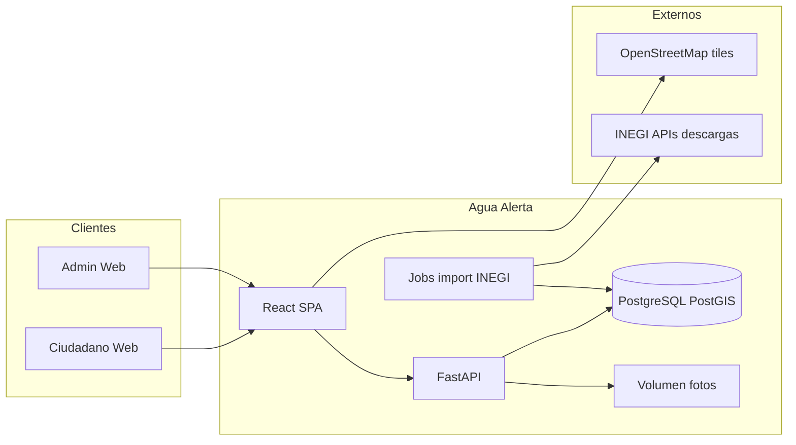

# Arquitectura del sistema

## Visión

Monolito modular desplegado como tres contenedores MVP: **frontend estático**, **API FastAPI**, **PostgreSQL+PostGIS**. Comunicación HTTPS/JSON. Fotos en volumen montado (evolución a object storage).

## Diagrama de contexto

## Versiones recomendadas

Ver tabla en [../02-requirements/non-functional-requirements.md](../02-requirements/non-functional-requirements.md#versiones-de-stack-fijar-en-dependencias-al-implementar).

**Compatibilidad crítica:**

- GeoPandas/Shapely deben construirse contra la misma versión GEOS del contenedor PostGIS client libs en jobs ETL.
- `react-leaflet@4` con React 18.
- SQLAlchemy 2.0 + geoalchemy2 (dependencia adicional propuesta) para geometrías.

## Capas lógicas (backend)

| Capa | Responsabilidad |
|------|-----------------|
| `api/routers` | HTTP, auth deps, paginación |
| `schemas` | Pydantic request/response |
| `services` | Reglas de negocio, orquestación |
| `repositories` | SQLAlchemy queries, espacial |
| `domain` | Enums, constantes, scoring puro |
| `integrations/inegi` | Clientes HTTP/descarga |
| `tasks` | Import batch, recálculo urgencia |

## Capas lógicas (frontend)

| Capa | Responsabilidad |
|------|-----------------|
| `pages` | Rutas ciudadano/admin |
| `features/reports` | Formulario, mis reportes |
| `features/incidents` | Mapa público, confirmación |
| `features/admin` | Dashboard, tablas |
| `shared/ui` | Design system |
| `shared/api` | Cliente OpenAPI tipado |
| `shared/map` | Leaflet wrappers |

Estructura detallada: [backend-architecture.md](./backend-architecture.md), [frontend-architecture.md](./frontend-architecture.md).

## Decisiones clave

| Tema | Decisión |
|------|----------|
| Estilo arquitectónico | Monolito modular |
| Auth | JWT access (15 min) + refresh (7 días) |
| SRID | 4326 (WGS84) en `reports.location`, `incidents.centroid` |
| Idempotencia confirmaciones | UNIQUE (`incident_id`, `user_id`) |
| Cola/async | Síncrono MVP; Celery/RQ post-MVP para ETL pesado |

ADRs: [architecture-decisions.md](./architecture-decisions.md), [../13-decisions/adr-template.md](../13-decisions/adr-template.md).