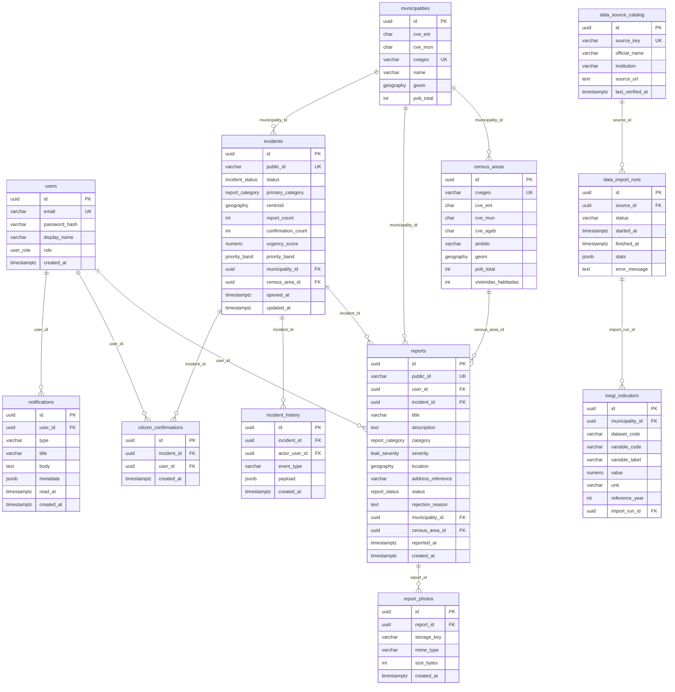

# Diagrama entidad-relación

## Mermaid ER (tablas físicas)

## Tablas adicionales justificadas

| Tabla | Motivo |
|-------|--------|
| `citizen_confirmations` | Corroboración sin duplicar reportes |
| `notifications` | MVP in-app |
| `data_source_catalog` / `data_import_runs` | Trazabilidad INEGI |
| `users.role` enum | RBAC tres roles |

## Eliminaciones respecto al listado inicial

No se crea tabla separada `roles`; el rol vive en `users.role` (MVP simple). Escalar a `roles`/`user_roles` si aparecen permisos granulares.

Diccionario: [data-dictionary.md](./data-dictionary.md).