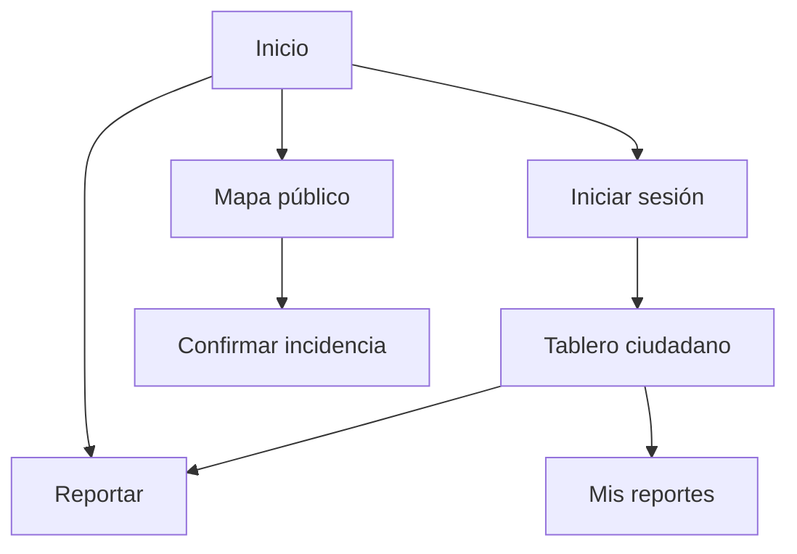

# Especificación UX/UI general

## Principios

- Mobile-first en flujo de reporte.
- Lenguaje claro, tono institucional cercano.
- Mapa como elemento central ciudadano.
- Accesibilidad: contraste, foco visible, labels asociados.

## Navegación ciudadana

## Estados transversales

| Estado | Comportamiento |
|--------|----------------|
| Carga | Skeleton en listas; spinner en mapa |
| Vacío | Ilustración + CTA reportar |
| Error | Mensaje accionable + reintento |
| Offline | Aviso si falla geolocalización |

## Responsive

- Breakpoints Tailwind default; formulario en una columna < md.
- Mapa altura mínima 50vh móvil.

Documentos por superficie: [citizen-interface.md](./citizen-interface.md), [admin-dashboard.md](./admin-dashboard.md).