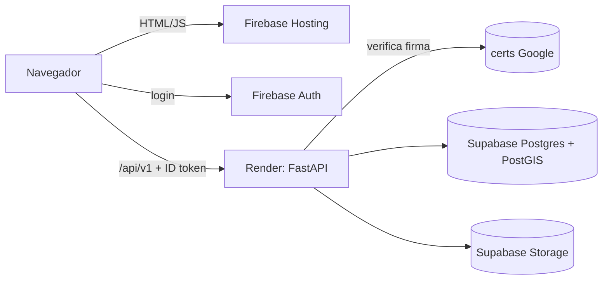

# Despliegue público gratuito

Toda la plataforma corre en planes gratuitos, sin tarjeta de crédito.

| Pieza | Servicio | Plan | Por qué |
|-------|----------|------|---------|
| Sitio web (SPA) | **Firebase Hosting** (`agua-alerta-mx`) | Spark | CDN + HTTPS; mismo proyecto que la autenticación |
| Cuentas | **Firebase Authentication** | Spark | Registro, verificación de correo, recuperación y cambio de contraseña sin servidor de correo propio |
| API FastAPI | **Render** Web Service (Docker) | Free | Ejecuta el `backend/Dockerfile` sin cambios |
| Base de datos | **Supabase** Postgres + **PostGIS** | Free (500 MB) | Las consultas geoespaciales (radio en metros, punto en polígono) exigen PostGIS; Firestore no las soporta |
| Fotografías | **Supabase Storage** (API S3) | Free (1 GB) | Firebase Storage exige plan Blaze desde oct-2024; las fotos se borran al cerrar cada caso |
| Mapa base | Esri World Light Gray | sin clave | Atribución incluida en el mapa |



Uso estimado de la base: ~12 MB de datos de INEGI (32 estados, 2,478 municipios, indicadores de agua)
más los reportes. Holgado dentro de los 500 MB.

## Limitaciones del plan gratuito (conocidas y aceptadas para el piloto)

- **Render Free se duerme** tras 15 min sin tráfico; la primera petición tarda ~50 s en despertar.
- **Supabase Free pausa el proyecto** tras 7 días sin actividad; se reactiva desde el panel.
- Una sola instancia de API: el rate limiting en memoria es efectivo; con varias réplicas habría que moverlo a la BD (H6).
- Las migraciones y la carga de INEGI corren al arrancar el contenedor (no hay *pre-deploy* en el plan gratuito).

## 1. Supabase (base de datos y fotos)

1. Crea un proyecto en <https://supabase.com/dashboard> (región cercana, p. ej. `us-east-1`). Guarda la contraseña de la BD.
2. **Connect → Connection string → Session pooler**: copia la URI
   (`postgresql://postgres.<ref>:<password>@aws-0-<region>.pooler.supabase.com:5432/postgres`).
   Usa el *session pooler*: la conexión directa del plan gratuito es solo IPv6 y Render no la alcanza.
   No hace falta activar PostGIS a mano: la primera migración ejecuta `CREATE EXTENSION postgis`.
3. **Storage → New bucket**: nombre `report-photos`, **privado** (sin acceso público).
4. **Storage → S3 Connection**: copia el *Endpoint* (`https://<ref>.supabase.co/storage/v1/s3`) y la *Region*;
   en *S3 Access Keys* crea una clave y guarda *Access key ID* y *Secret access key*.

## 2. Render (API)

1. En <https://dashboard.render.com> → **New → Blueprint** → conecta el repositorio de GitHub y elige la rama `main`.
   Render lee `render.yaml` y propone el servicio `agua-alerta-api`.
2. Completa las variables marcadas como secretas:

   | Variable | Valor |
   |----------|-------|
   | `DATABASE_URL` | URI del *session pooler* de Supabase |
   | `S3_ENDPOINT_URL` | Endpoint S3 de Supabase Storage |
   | `S3_REGION` | Región de Supabase Storage |
   | `S3_ACCESS_KEY_ID` / `S3_SECRET_ACCESS_KEY` | Clave S3 creada en Supabase |
   | `BOOTSTRAP_SUPERADMIN_EMAIL` | Tu correo de administración |

   `JWT_SECRET` y `JWT_REFRESH_SECRET` se generan solos. No pongas secretos en el repositorio.
3. Despliega. El primer arranque migra el esquema y carga los datos de INEGI (unos segundos).
   Verifica `https://agua-alerta-api.onrender.com/health/ready` → `{"status":"ready", ...}`.
   Si Render asignó otra URL (nombre ocupado), úsala en el paso 3.

## 3. Firebase Hosting (sitio)

El build de producción toma la configuración pública de Firebase de `frontend/.env.production`.
La URL de la API se pasa al construir:

```bash
cd frontend
VITE_API_BASE_URL=https://agua-alerta-api.onrender.com/api/v1 npm run build
cd ..
firebase deploy --only hosting --project agua-alerta-mx
```

Sitio: <https://agua-alerta-mx.web.app>

## 4. Primer acceso de administración

1. Entra a <https://agua-alerta-mx.web.app/registro> y crea tu cuenta **con el mismo correo** de `BOOTSTRAP_SUPERADMIN_EMAIL`.
2. Verifica el correo con el enlace que envía Firebase y vuelve a iniciar sesión.
3. La API vincula tu cuenta de Firebase con la de superadministración (solo si el correo está verificado)
   y aparece el menú **Administración**.

Para dar rol de administración a más personas: que se registren y, por ahora, actualizar `users.role`
desde el editor SQL de Supabase (`UPDATE users SET role = 'ADMINISTRADOR' WHERE email = '...'`).

## 5. Datos de INEGI

- Paquete versionado en `backend/data/inegi/` con su `manifest.json` (fuente, fecha, metadatos de INEGI).
- Se carga en cada arranque de forma idempotente (`python -m scripts.load_inegi_seed`).
- Para actualizarlo cuando INEGI publique un nuevo Marco Geoestadístico: `python -m scripts.build_inegi_seed`,
  revisar el diff del manifiesto y hacer commit; el siguiente despliegue lo recarga.

## Privacidad y retención

- La ubicación del navegador solo se usa para resolver estado/municipio (`/regions/locate`); no se almacena.
  Lo que se recuerda es la región elegida, en una cookie de primera parte (`aa_region`, 180 días).
- Las fotos se re-codifican sin EXIF (GPS) al subir y **se eliminan** cuando la incidencia pasa a
  *resuelta* o *descartada*; queda el evento `photos_purged` en el historial.
